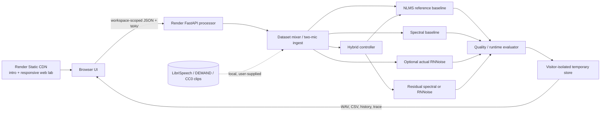

<div align="center">

# त्रिSHUL VANI

**Adaptive Speech Enhancement · Dual-Microphone DSP · Reproducible Research**

`VOLTEDGE ENGINEERING / SOFTWARE RESEARCH WORKBENCH / ALPHA 0.2`

**A connected spectral studio and speech-enhancement research laboratory with real processing, reproducible records, auditable metrics, and automated tests.**

[](https://trishul-vani-frontend.onrender.com/)
[](https://github.com/TrishulVani/trishul-vani-studio/actions)
[](https://github.com/TrishulVani/trishul-vani-studio)

</div>

> [!IMPORTANT]
> **Research prototype.** No claims of certified real-time performance, speech recognition, hearing protection, tactical safety, secure voice communication, or completed Raspberry Pi deployment. Neural inference only runs when a genuine FFmpeg-compatible RNNoise model is configured; otherwise the UI explicitly displays a **spectral DSP fallback**. Synthetic voice is **not real speech**.

### Release editions

The current cinematic experience is the **main website** at [trishul-vani-frontend.onrender.com](https://trishul-vani-frontend.onrender.com/). The previous mint introduction and original dashboard remain available as **Version 2 / Original Edition** at [trishul-vani-frontend.onrender.com/design-v2/](https://trishul-vani-frontend.onrender.com/design-v2/). Both use the same Python audio processor. The version labels describe the public addresses, not separate DSP implementations.

**New hardware workbench:** [Open the local Design 02 hardware lab](http://127.0.0.1:8002/hardware.html) to inspect the supplied prototype's adapted 3D enclosure, build a logical dual-microphone circuit with Raspberry Pi 4 Model B, Pico W and ESP32-S3 controller options, test bounded virtual control scripts and send a synthetic experiment through the real Python backend. Runs can be opened directly in the V2 audio laboratory. This is a **virtual design and software test**, not Raspberry Pi or electrical emulation; see [scope, usage and limits](docs/HARDWARE_WORKBENCH.md). The Hindi **त्रि** wordmark now uses a larger, crisp Devanagari font on V2.

**MK-V work-in-progress preview:** [Open the local product and evidence mode](http://127.0.0.1:8002/hardware-mkv.html). It combines clearly labelled concept artwork, the inspectable MK-IV assembly, connection and controller bench, and actual FastAPI RAW/NLMS/Spectral/Hybrid audio from one experiment. Run the five seeded noise scenarios and compare WAVs at matched playback time. The waveform panels use one common amplitude scale. This connected mode is part of the main website candidate; see [MK-V implementation and evidence](docs/hardware-mkv/IMPLEMENTATION.md).

The `feat/immersive-story` candidate uses a continuous obsidian, forest-metal and restrained gold/copper atmosphere with Syne display type and Manrope UI text. [Preview the scroll-controlled trident intro locally](http://127.0.0.1:8002/experience.html), or [open the connected V2 landing and lab](http://127.0.0.1:8002/index.html?design=2). The mixed-script V2 wordmark begins with Hindi **त्रि**. The intro follows the supplied trident animatic's upright awakening, turn, throw and impact, with smoother site-native motion: the trident rotates gently around its upright axis at rest, then wheel, touch or keyboard input drives and reverses the strike. Completing the impact, Enter Site or Escape enters the working app. The subsequent single scroll narrative starts with pointer-responsive acoustic waves and moving blocks; engraved notation ribbons cross the growing woman as a separate cutout carries her through an interstellar signal corridor, into a glass break, a rear-view flying-wing cockpit, a fly-off and the working audio laboratory. All scroll movement reverses when scrolling back. The earlier Ground/Sea/Air panels were removed. A separate B-2 concept flyover still opens the landing; its 51 KB WebP came from the user-supplied `B2_Spirit_Scroll_Flyover.html`. The corridor plate, flying operator cutout and cockpit compositions are original generated concept art using the existing operator artwork as a character reference. The supplied recording, animatic and theme preview informed choreography and palette; their captured frames, site assets and code were not copied. The user's gold glyph recurs through V2. All aircraft imagery is illustrative, not Indian Army, Navy or Air Force equipment or service testing. The optional synthetic comparison, measured RMS waveform and STFT spectrogram still use the real FastAPI processor. Audio never autoplays. The cinematic design is assigned to the main address; the previous mint edition is assigned to the separate Version 2 address.

Run the browser tests with `pnpm install && pnpm exec playwright install chrome && pnpm exec playwright test`. They cover desktop, tablet and mobile navigation, idle/scroll trident motion, forward/reverse flyover and cockpit narrative, the return to the lab, the connected WAV/STFT comparison, reduced motion, disconnected processor behavior, laboratory measurement/CSV export, and a non-destructive spectral edit with WAV exports. CI runs these alongside the existing Python, DSP and Docker checks.

## Two live designs · one connected v0.2 engine

Implemented: real STFT visualization, non-destructive attenuation/isolation, immutable source layers, previews, undo/redo, A/B playback, external WAV references, and WAV/JSON exports. The Python lab includes controlled experiments, NLMS, spectral gating, hybrid processing and measured metrics.

### Open the working application

| Destination | URL | Purpose |
|---|---|---|
| Main website (improved Version 1) | **https://trishul-vani-frontend.onrender.com/** | Cinematic trident introduction, signal story, connected dashboard and studio; static CDN, no Render web-service wake-up |
| Version 2 / Original Edition | **https://trishul-vani-frontend.onrender.com/design-v2/** | Previous mint introduction and original connected dashboard |
| Direct Python application | https://trishul-vani-studio.onrender.com/ | FastAPI dashboard, experiment lab and spectral editor |
| Spectral workspace | https://trishul-vani-studio.onrender.com/studio.html | Direct editor access if a browser blocks embedded cookies |
| API documentation | https://trishul-vani-studio.onrender.com/docs | Interactive endpoint reference |

The main address serves the cinematic frontend from Render Static Sites' global CDN, so the intro and interface do not wait for the sleeping Python web service. It sends only `/api/...` processing requests to the separate Render API. A random browser-local capability isolates each visitor without third-party cookies. The Original Edition remains available at its separate path. See [`docs/DEPLOYMENT.md`](docs/DEPLOYMENT.md).

### First-visit guidance

On the preview branch, Mission Control and Spectral Studio include a **? Help & tour** control in both designs. The five-step guided tour highlights real controls across both screens, can be skipped or replayed, and stores only the tour choice in browser local storage. The 80-second product video is **not yet recorded**; see [`docs/TUTORIAL_STORYBOARD.md`](docs/TUTORIAL_STORYBOARD.md) and caption draft for the planned authentic screen capture. The processor badge checks `/api/health` and `/api/meta`, reports disconnection honestly, and offers Retry.

### Visual experience and flow

1. The public address opens on an original, sculpted trident and animated signal field. It enters the connected dashboard automatically after 8.5 seconds; the Enter button and Escape key can advance earlier.
2. The dashboard is the actual working application. Start a synthetic experiment, import your own WAV/FLAC recordings, or launch the spectral editor. The browser stays at the public address while navigating inside the embedded workspace.
3. The cinematic experience opens on the main address. Its trident intro waits for scroll, touch or keyboard input while rotating gently at rest; the completed strike takes the visitor into the connected landing. That landing combines a reversible aircraft flyover, a framed acoustic chamber and the operator-to-corridor-to-glass-to-cockpit-to-lab journey. The palette follows the supplied V4 atmosphere brief across the intro, landing, lab and editor. Motion reduces when the visitor requests reduced motion. [Lusion](https://lusion.co/), [Spaace](https://lusion.co/projects/spaace/) and [DDD 2024](https://lusion.co/projects/ddd_2024/) informed the pacing and spatial composition; their images, code and branding are not used.

The public website and backend are separate Render services: the static site publishes [`web/`](web/) to the global CDN and the existing web service runs this repository's Python processor. GitHub remains source control and CI; it does not serve the public site.

### Release and CI/CD

- **Main website / improved Version 1:** the cinematic intro, landing and connected lab are at the root address.
- **Version 2 / Original Edition:** the previous mint intro and default dashboard live at `/design-v2/`. The two editions use the same v0.2 alpha DSP and API.
- GitHub Actions runs Python 3.11/3.12 API and DSP tests, JavaScript syntax/DSP tests, Design 02 asset checks and a Docker build on pushes and pull requests. The workflow is in [`.github/workflows/ci.yml`](.github/workflows/ci.yml).
- Render publishes the `web/` static frontend to its CDN and automatically builds this repository's `main` Docker image for the Python API. Feature-branch CI is checked before merging; main CI runs alongside deployment and does not gate it. See the [deployment guide](docs/DEPLOYMENT.md) for configuration and verification.

> [!NOTE]
> Render's free processor can take about a minute to wake after inactivity, but it no longer blocks the website or its intro. The frontend starts waking it immediately. Hosted workspaces use an unguessable browser-local capability; storage remains temporary and resets when the service restarts. Export WAV, CSV and JSON results you need to retain.

## What is working now

| Area | Status | Evidence |
|---|---|---|
| Responsive interactive web workbench | ✅ Built | `web/index.html`, `web/styles.css`, `web/app.js` |
| Python/FastAPI REST backend | ✅ Built | `app/main.py`, OpenAPI at `/docs` (see note below) |
| Synthetic stationary/changing/impulsive noise | ✅ Built | Factory, engine, wind, crowd, impulse; seeded generators |
| Clean + noise controlled SNR mixture | ✅ Built | SNR calibrated on the entire waveform, common gain clipping prevention |
| Reference-mic NLMS adaptive cancellation | ✅ Built | `app/dsp.py` + repeatable tests |
| Spectral DSP reference baseline | ✅ Built | `app/dsp.py`, explicitly not labelled neural |
| Hybrid controller (gating, freeze, fallback) | ✅ Prototype | DSP fallback works; RNNoise only with optional real model |
| Actual RNNoise neural inference | ⚙️ Optional | Configure compatible model in `RNNOISE_MODEL` |
| Upload clean speech + noise | ✅ Built | UI/API accepts WAV/FLAC; computes known-reference metrics |
| Upload synchronized primary and ambient recordings | ✅ Built | SNR/STOI/PESQ intentionally N/A without clean reference |
| Experiment playback, waveform, method comparison | ✅ Built | Four methods, optional fifth when model is present |
| SNR, STOI, PESQ*, processing time, RTF, CSV export | ✅ Built | Only when mathematically available; *PESQ requires optional package/licensing check |
| Local provenance and repeatable histories | ✅ Built | Persist WAV, parameters, control trace and metrics per run |
| Dataset benchmark CLI with hashes/CSV/manifest | ✅ Built | `scripts/evaluate_dataset.py` |
| Unit and end-to-end API tests | ✅ Built | `pytest` |
| GitHub Actions CI | ✅ Configured | `.github/workflows/ci.yml` |
| C++/Raspberry Pi and actual two-node link | ◻ Planned | Detailed gates in `docs/ROADMAP.md` |

## Quick start (Windows PowerShell / Linux / macOS)

```powershell
# From the repository root:
python -m venv .venv
# Windows:
.\.venv\Scripts\Activate.ps1
# Linux/macOS: source .venv/bin/activate
python -m pip install --upgrade pip
pip install -r requirements.txt
pip install -r requirements-dev.txt
python -m pytest
python -m uvicorn app.main:app --reload --host 127.0.0.1 --port 8000
```

Then open **http://127.0.0.1:8000**. Interactive REST API docs: **http://127.0.0.1:8000/docs** (FastAPI docs route is registered before the static mount). No JavaScript build step, npm subscription, paid API key, database server, or cloud account required. Fonts use online enhancement *only when reachable*, with system fallbacks.

For private durable storage or sensitive recordings, run the application locally. The public service is a bounded research demonstration, not a durable multi-user archive.

### Docker (optional)

```bash
docker compose up --build
```

Open the same local URL. In Compose, the server binds to **127.0.0.1**, and output files persist in a named Docker volume.

## Research workflow

1. Open the **Audio laboratory**. Choose a noise class, controlled input SNR (-15 to +20 dB), duration and deterministic seed.
2. Click **Run signal analysis**. The backend creates clean synthetic test signals, reference-mic noise, raw mixture, NLMS, spectral output and hybrid output.
3. Compare waveform, listen to **RAW / NLMS / SPECTRAL / HYBRID**, inspect computed SNR, objective metrics if applicable, processing time and RTF.
4. Download WAV and per-run CSV. Each run is persisted at `artifacts/<run_id>/` and can be re-opened from history.
5. **Use real human speech before interpreting STOI or PESQ.** Upload speech + noise WAV/FLAC via the UI. Data sources and licensing are in Dataset vault and `docs/DATA_PROVENANCE.md`.
6. Upload *paired, synchronized* mic recordings through the dual-mic importer once captured. With no true clean ground truth, SNR and intelligibility quality metrics are deliberately unavailable.
7. Execute multi-file benchmark matrix via the CLI, store licenses, hashes and exact source paths for presentation-ready evidence.

### Benchmark actual public datasets

Download **only the speech/noise subset you are licensed to use**, retain its original terms, then:

```bash
python -m scripts.evaluate_dataset \
  --speech-dir data/LibriSpeech/dev-clean \
  --noise-dir data/DEMAND \
  --speech-license 'CC BY 4.0' \
  --noise-license 'CC BY-SA 3.0' \
  --limit 3 \
  --snrs -10 -5 0 5 10 \
  --duration 3 \
  --out-dir artifacts/benchmark-librispeech-demand
```

The benchmark writes `metrics.csv`, `summary.csv` (means and standard deviations), `manifest.json` (file SHA-256, seed, source terms and commit), and a small group of WAV examples. **It does not download or commit datasets.** Data in `data/` should be `.gitignore`d and stored locally or in approved research storage.

### Optional real RNNoise (neural) path

The app does **not bundle neural models**. For real RNNoise: install an FFmpeg build that contains the `arnndn` filter, obtain a compatible `.rnnn` model from a source whose model license you have verified, and set an absolute path to the model before starting the backend:

```bash
# Linux/macOS:
export RNNOISE_MODEL=/absolute/path/to/verified-model.rnnn
ffmpeg -filters | grep arnndn
# Windows PowerShell:
$env:RNNOISE_MODEL='C:\models\verified-model.rnnn'
```

A valid model enables **RNNoise** as a *separate* fifth method and changes the hybrid residual stage from spectral to actual neural inference. Misconfigured models raise errors, not fake results. The reference RNNoise interface uses 48 kHz internally; FFmpeg handles conversion from/to the 16 kHz research pipeline. Measure delay after integration. Code is not a neural training system.

### Benchmarks, limitations, interpretation

- **SNR** is an error-based `10log10(Pclean / P(clean−enhanced))` for known, time-aligned clean reference. It is not a subjective quality measurement and is marked `null` without clean reference.
- **STOI** (via `pystoi`) and **PESQ** (optional) are used for *real speech with known clean reference*; we intentionally do **not** give the synthetic tone a meaningful intelligibility score.
- **RTF** is offline processing time divided by audio duration. RTF < 1 on a host **does not prove** glitch-free playback or <10 ms real-time latency on Raspberry Pi.
- **Reference gating** based on short-frame correlation is an initial policy to tune on synchronized real recordings. It is not robust to all speech leakage, multipath propagation, or high-energy transients; validation gates must address this.
- Do not present software-inferred results as measured military gunfire, vehicle, or battlefield performance. Simulated impulse and engine signals are **proxies**, not field recordings.
- Generated/audio artifacts use signed PCM16 WAV: processing outputs are clipped to valid WAV range. Peak and clipped-sample counts are saved for analysis. Examine clipping counts before treating outputs as comparable.

## Architecture



The longer-term target remains **Operator A → Node A / reference-mic NLMS → residual neural stage → wired link → Node B → Operator B**. AKSHARA is optional, **after** the reliable two-node demonstration; it is not part of the core software scope.

## Repository map

```text
app/                   FastAPI, WAV input/output, experiment orchestration
  dsp.py               Algorithms, simulated sources, optional genuine RNNoise
  main.py              API, validation, local persistence and static web
web/                   Zero-build responsive UI (CSS, JS, SVG)
scripts/               Offline benchmark, reproducibility manifests
tests/                 Deterministic DSP tests, API end-to-end tests
docs/                  Architecture, dataset licenses, validation, build strategy
.github/workflows/     Continuous integration pipeline
artifacts/             Gitignored results (CSV, WAV, JSON, provenance)
CODEX_MASTER_PROMPT.md  Task contract for Codex to finish software progressively
```

## API surface

| Endpoint | Function |
|---|---|
| `GET /api/health` | Connectivity |
| `GET /api/meta` | Honest method/capability flags |
| `GET /api/diagnostics` | Infrastructure state, no pretend Pi telemetry |
| `POST /api/experiments/simulate` | Deterministic synthetic environment |
| `POST /api/experiments/upload` | Real clean speech and noise files |
| `POST /api/experiments/dual-mic` | Recorded synchronized primary/reference mic WAV |
| `GET /api/experiments` | Stored history |
| `GET /api/experiments/{id}` | Full report, trace, metrics, waveforms |
| `GET /api/experiments/{id}/audio/{method}` | 16 kHz WAV download and playback |
| `GET /api/experiments/{id}/export.csv` | Auditable per-method CSV |
| `GET /api/datasets` | Source URLs, use and license warnings |
| `GET /docs` | OpenAPI UI |

## Contributing + Git hygiene

Every software milestone is committed separately with tests and documentation. See `CONTRIBUTING.md` and `CODEX_MASTER_PROMPT.md`. Do **not** commit third-party WAVs, models, datasets, tokens or unvalidated benchmark images. The public repository is [`TrishulVani/trishul-vani-studio`](https://github.com/TrishulVani/trishul-vani-studio); design work is developed on feature branches and integrated into `main` after validation.
